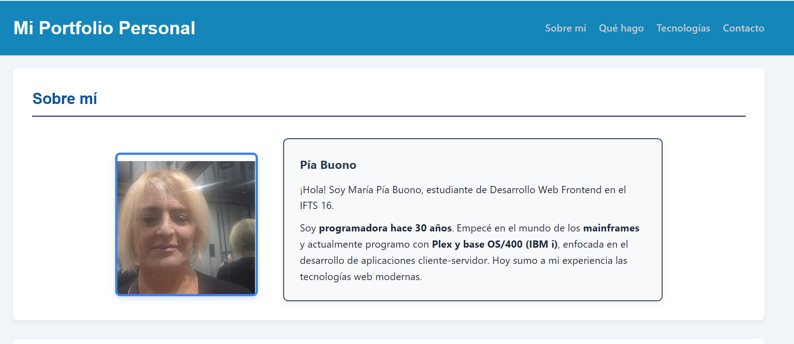

# Portfolio Personal - María Pía Buono

Portfolio personal desarrollado para la materia **Desarrollo Web Frontend** del **IFTS 16**. Presenta mi experiencia, los servicios que ofrezco y las tecnologías que utilizo.

## Vista previa



## Secciones

- **Sobre mí:** presentación personal y foto de perfil.
- **Qué hago:** experiencia y áreas de especialización.
- **Tecnologías y habilidades:** tabla con tecnologías, nivel y categoría.
- **Contacto:** formulario con campos para nombre, apellido, email y teléfono.
- **Redes sociales:** enlaces a Facebook e Instagram en el pie de página.

## Características

- Estructura semántica HTML5 con `header`, `nav`, `main`, `section`, `article` y `footer`.
- Diseño con CSS3 y Flexbox para organizar los contenedores.
- Anchos relativos y diseño adaptable a distintos tamaños de pantalla.
- Cuatro puntos de corte responsivos: 1080 px, 768 px, 480 px y 375 px.
- Filas de la tabla de tecnologías coloreadas alternadamente y resaltadas al pasar el cursor.

## Estructura del proyecto

```text
/
├── index.html
├── README.md
├── css/
│   └── styles.css
└── img/
    ├── pia.png
    └── muestra.png
```

Para ver el portfolio, abre `index.html` en un navegador.
